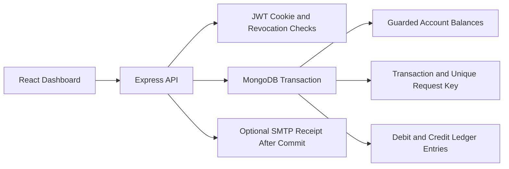

# Vault — Bank Transaction System

A full-stack banking portfolio application built with **React, TypeScript, Node.js, Express, and MongoDB**. Vault supports multiple accounts, secure authentication, internal transfers, transaction history, and a balanced ledger in a responsive dashboard.

**All money is simulated. This application does not connect to real bank accounts or payment networks.**

## 🚀 Live Demo

**[Open Vault Banking System](https://banking-system-jisa.onrender.com/)**

Explore the deployed application and test its banking workflows.

> **Demo access:** Use the demo credentials below only if the corresponding accounts are available in the deployed environment. Never use real banking credentials.

## Features

- **Authentication:** Sign up and sign in using bcrypt-hashed passwords and HttpOnly session cookies.
- **Multiple accounts:** Open up to five savings accounts and view ledger-derived balances.
- **Internal transfers:** Look up recipients, review transfers, and confirm payments.
- **Transaction safety:** Atomic transfers, ownership checks, balance limits, and protection against concurrent overspending.
- **Transaction history:** Search and filter by account, direction, and date, with pagination and CSV export.
- **Idempotency:** Prevent duplicate completed transfers when requests are retried.
- **Sandbox funding:** Add simulated funds when `SANDBOX_FUNDING=true`.
- **Email receipts:** Optional SMTP transaction receipts, delivered on a best-effort basis.
- **Responsive interface:** Accessible dialogs, loading states, empty states, and error handling.

## Tech Stack

| Layer | Technologies |
|---|---|
| Frontend | React, TypeScript, Vite |
| Backend | Node.js, Express |
| Database | MongoDB |
| Authentication | JWT, HttpOnly cookies, bcrypt |
| Testing | MongoDB replica set, integration tests |
| Deployment | Render |

## Start Locally

Requires Node.js **22.12 or later** and npm.

From the project directory, run:

```sh
npm install
npm run demo
```

Open [http://localhost:5173](http://localhost:5173) and select **Take a look with the demo account**, or sign in with the demo credentials displayed by the application.

The demo starts an isolated local MongoDB replica set with synthetic transaction history. The first run downloads the MongoDB binary; subsequent launches reuse the cached binary.

Stop the application with `Ctrl+C`. Demo data resets when the demo stops. The configured Atlas database is not used by the demo or integration tests.

Try sending ₹125.50 to Ananya, then sign in as Ananya to verify the matching credit. Brijesh also has account `100000000003` for testing transfers between his own accounts. Adding money creates clearly labelled sandbox deposits, not real payments.

## Connect Persistent MongoDB Data

Initialize the local configuration:

```sh
npm run setup
```

This creates `server/.env` and generates a private JWT signing secret.

Add your MongoDB Atlas connection string to `MONGODB_URI` in that file, then run:

```sh
npm run db:check
npm run dev
```

Open [http://localhost:5173](http://localhost:5173) and register an account. Your own database starts empty and does not automatically contain the demo users.

See [the MongoDB connection guide](docs/CONNECT-MONGODB.md) for Atlas configuration and optional email setup.

Keep `CLIENT_ORIGIN` set to `http://localhost:5173` for development. The API listens on loopback, and the frontend proxies `/api` requests to it. If you change these ports, update `client/vite.config.ts` and the environment variables together.

**For the hosted application:** Configure the production MongoDB connection, environment variables, and frontend origin in Render. Do not assume that local demo data or credentials are available in the deployed database.

## How Transaction Correctness Works

Amounts are accepted as decimal INR strings and stored as integer paise to avoid floating-point money calculations.

Each transfer uses a single MongoDB transaction to:

1. Debit the source account.
2. Credit the destination account.
3. Save the transaction record.
4. Insert two balanced ledger entries.

A guarded materialized account balance helps prevent concurrent overspending, while displayed balances are aggregated from ledger entries.

A unique `(actorId, idempotencyKey)` index prevents repeated submissions from creating duplicate completed transactions. A request fingerprint rejects reuse of the same key with different transfer details.

MongoDB retries transient write conflicts, and transaction failures roll back balance and ledger changes. Deposits include a matching debit to an internal sandbox clearing account.

### Transaction Flow



See [API-CONTRACT.md](docs/API-CONTRACT.md) for routes, fields, and response formats.

## Payment Recovery

Pending payments retain their original request key and exact details in browser session storage until their outcome is confirmed.

Closing the dialog or reloading the same tab restores the pending payment. Saved payment details are scoped to the signed-in user; authentication tokens remain in HttpOnly cookies.

If a payment is unconfirmed, resume it before starting a different one.

## Dashboard and Reporting Notes

Dashboard **money in** and **money out** include all account ledger activity, including transfers between your own accounts. These transfers generate both a debit and a credit, so your combined balance remains unchanged.

Chart days and date filters use UTC. Individual timestamps are displayed in the browser's local time.

## Project Structure

```text
client/src/       React views, forms, API client, and styling
server/src/       API, authentication, validation, ledger services, and models
server/scripts/   Safe database connection check
server/test/      Integration tests using an isolated MongoDB replica set
scripts/          Local setup and isolated demo launcher
docs/             API contract and database connection instructions
```

## Verify the Project

Run the integration tests:

```sh
npm test
```

Build the application:

```sh
npm run build
```

Run all checks:

```sh
npm run check
```

The integration tests use their own database rather than `MONGODB_URI`. They cover authentication, authorization, malformed inputs, atomic transfer failures, duplicate requests, concurrent spending, ledger conservation, filtering, and CSV export.

The first test run downloads the same MongoDB binary used by the demo.

See [VERIFICATION.md](docs/VERIFICATION.md) for completed checks and external services that still need configuration.

The included GitHub Actions workflow runs these checks when changes are pushed to GitHub. Dependencies are recorded in `package-lock.json` for reproducible installation.

## Run the Built Application

After configuring MongoDB:

```sh
npm run build
npm start
```

Express serves the compiled frontend on port `4000`.

For direct local use of the built version, set:

```env
CLIENT_ORIGIN=http://localhost:4000
```

For development, use:

```env
CLIENT_ORIGIN=http://localhost:5173
```

## Deployment Configuration

For a hosted installation, configure:

- A persistent MongoDB replica set.
- `NODE_ENV=production`.
- `CLIENT_ORIGIN` matching the public HTTPS origin of the frontend.
- A private JWT signing secret.
- `HOST=0.0.0.0` where required by the hosting environment.
- Proxy trust appropriate to the host's network topology.
- SMTP settings if email receipts are enabled.

Use your hosting provider's environment-variable manager for production secrets. Never commit `.env` files, database credentials, or signing secrets to GitHub.

The included Dockerfile provides an additional container deployment option.

See [the deployment guide](docs/DEPLOYMENT.md) for exact configuration details.

## Scope and Limitations

Vault is an educational portfolio application. It implements simulated internal account transfers, not real-money deposits, withdrawals, KYC, card payments, password resets, or bank integrations.

Email delivery is optional and best effort rather than a durable delivery queue. Rate limits operate per application process; horizontally scaled hosting would require a shared limit store.

Demo balances and credentials must remain isolated from any public production dataset.
