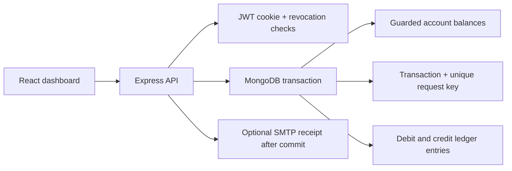

# Vault — Bank Transaction System

A complete personal banking portfolio application built with **React, TypeScript, Node.js, Express and MongoDB**. It supports accounts, transfers and a balanced ledger in a responsive dashboard. All money is simulated; this application does not connect to payment rails or real bank accounts.

## Start with the demo

Requires Node.js **22.12 or later** and npm. From this project folder:

```sh
npm install
npm run demo
```

Open **http://localhost:5173** and select **Take a look with the demo account**, or sign in with:

| User | Email | Password | Account number |
| --- | --- | --- | --- |
| Brijesh Gaur | brijesh@vault.demo | VaultDemo123! | 100000000001 |
| Ananya Sharma | ananya@vault.demo | VaultDemo123! | 100000000002 |

The demo runs a real, isolated local MongoDB replica set with synthetic history. The first run downloads MongoDB (the Windows archive is approximately 600 MB); later launches reuse the cached binary. Stop with Ctrl+C. Demo data resets when stopped. Your configured Atlas database is never used by the demo or integration tests.

Try sending ₹125.50 to Ananya, then sign in as Ananya to see the matching credit. Brijesh also has account `100000000003` for testing transfers between his own accounts. Add money creates clearly labelled sandbox deposits, not real payments.

## Connect persistent MongoDB data

```sh
npm run setup
```

This creates `server/.env` and generates a private JWT signing secret. Add your MongoDB Atlas connection string to `MONGODB_URI` in that file, then:

```sh
npm run db:check
npm run dev
```

Open http://localhost:5173 and register your account. Stop the demo before running this mode, since both use ports 4000 and 5173. Your own database starts empty, with no demo users. See **[the MongoDB connection guide](docs/CONNECT-MONGODB.md)** for Atlas setup and optional email configuration.

Keep the browser at `http://localhost:5173`, matching `CLIENT_ORIGIN`; the API listens on loopback and the frontend proxies `/api` requests to it. If you change these ports, update `client/vite.config.ts` and the environment values together.

## Features

- Sign up and sign in with hashed passwords and an HttpOnly session cookie; logout revokes the JWT until expiry.
- Open up to five savings accounts; see balances calculated from the ledger.
- Look up a recipient, review a transfer and confirm it; retries use the same request key.
- Transfer atomically with balance limits, ownership checks and protection against simultaneous overspending.
- View seven days of credit/debit activity and recent transactions.
- Search and filter history by account, direction and date, with pagination and CSV export.
- Add simulated funds when `SANDBOX_FUNDING=true`; turning it off disables the funding API and controls.
- Optional SMTP transaction receipts. Delivery is best effort and does not change a completed transfer.
- Responsive layouts, keyboard-accessible dialogs, and loading, empty and error states.

Dashboard “money in” and “money out” include all account ledger activity, including transfers between your own accounts. Those transfers have both a debit and a credit, so your combined balance stays unchanged. Chart days and date filters use UTC; individual timestamps are displayed in the browser's local time.

## How correctness works

Amounts are accepted as decimal INR strings and stored as integer paise. Each transfer uses a single MongoDB transaction to debit the source, credit the destination, save the transaction and insert two balanced ledger entries. A guarded materialized account balance prevents concurrent overspending. Displayed balances are aggregated from ledger entries.

A unique `(actorId, idempotencyKey)` index ensures repeated submissions cannot create another completed transaction. A request fingerprint rejects reuse of the same key with different data. MongoDB retries transient write conflicts, and any transaction failure rolls back all balance and ledger changes. Deposits have a matching debit to an internal sandbox clearing account.



See [API-CONTRACT.md](docs/API-CONTRACT.md) for routes, fields and response shapes.

Pending payments retain their original request key and exact details in browser session storage until the outcome is confirmed. Closing the dialog or reloading the same tab restores the pending payment. The saved data is scoped to the signed-in user; authentication tokens remain in HttpOnly cookies. If a payment is unconfirmed, resume it before starting a different one.

## Project structure

```text
client/src/          React views, forms, API client and styling
server/src/          API, authentication, validation, ledger services and models
server/scripts/     Safe database connection check
server/test/        Integration tests using an isolated MongoDB replica set
scripts/            Local setup and isolated demo launcher
docs/               API contract and database connection instructions
```

## Verify the project

```sh
npm test             # Real MongoDB integration tests
npm run build        # TypeScript check and optimized frontend build
npm run check        # TypeScript, integration tests and build
```

Tests create their own database; they do not connect to `MONGODB_URI`. They cover authentication, authorization, malformed inputs, atomic transfer failures, parallel duplicate requests, concurrent spending, ledger conservation, filtering and CSV export. The first test run downloads the same MongoDB binary used by the demo.

See [VERIFICATION.md](docs/VERIFICATION.md) for the checks completed and external services still to configure.

The included GitHub Actions workflow runs these checks when pushed to GitHub. Dependencies are recorded in `package-lock.json` for reproducible installation.

## Run the built application

After configuring MongoDB:

```sh
npm run build
npm start
```

Express serves the compiled frontend on port 4000. For direct local use of this built version set `CLIENT_ORIGIN=http://localhost:4000` before starting. For development, set it back to `http://localhost:5173`.

For a hosted installation use a long-running Node process, a MongoDB replica set, `NODE_ENV=production`, and `CLIENT_ORIGIN` equal to the public HTTPS origin. Set `HOST=0.0.0.0` on a managed host or container; the local default binds to loopback. Set proxy trust to match your host's topology and configure SMTP through its environment manager. The included Dockerfile provides a container option. See [the deployment guide](docs/DEPLOYMENT.md) for exact settings. Publishing and external service configuration are separate from local setup.

## Scope and limitations

This is an educational portfolio application. It implements internal account transfers, not real-money deposits, withdrawals, KYC, card payments, password reset or bank integrations. Email is optional and best effort rather than a durable delivery queue. Rate limits are per application process; horizontally scaled hosting would need a shared limit store. Demo balances and credentials must remain isolated from any public production dataset.
